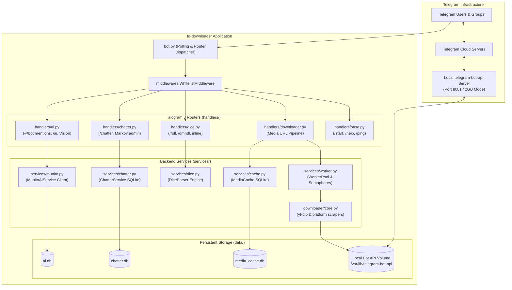

# Architecture Documentation: `tg-downloader` (Bard-Bot)

## 1. Overview & System Philosophy

`tg-downloader` is an asynchronous, multi-purpose Telegram bot built with **Python 3.11+**, **aiogram 3**, and **yt-dlp**. It is engineered specifically to operate reliably on resource-constrained ARM64 hardware (such as a **Raspberry Pi 4 / 5**) in a 24/7 production environment.

The system is designed around four core tenets:
1. **Modularity & Single Responsibility**: Domain logic is decoupled into independent aiogram `Router` modules (`handlers/`), background services (`services/`), and extraction adapters (`downloader/`).
2. **Zero-Waste Concurrency**: Asynchronous queues (`services.worker.MediaWorkerLimiter`) and singleflight locks prevent CPU and RAM starvation from media processing while keeping interactive bot commands instantaneous.
3. **High-Speed Persistent Caching**: Frequent requests and reposts bypass heavyweight downstream APIs via persistent SQLite WAL caching (`data/media_cache.db`), delivering cached media within milliseconds.
4. **Resilient Local File I/O**: Local Telegram Bot API server integration allows uploading files up to **2GB**, bypassing Telegram's default 50MB cloud threshold.

---

## 2. High-Level Architecture Diagram



---

## 3. Directory & Module Responsibilities

```
tg-downloader/
├── bot.py                  # Application bootstrap: service instantiation, middleware, polling loop
├── config.py               # Environment configuration, type parsing, and safety bounds
│
├── handlers/               # aiogram 3 Routers (presentation & interaction layer)
│   ├── __init__.py         # Master router aggregating all domain sub-routers in priority order
│   ├── base.py             # Basic informative commands: /start, /help, /ping, /id
│   ├── downloader.py       # Media pipeline: URL detection, queueing, cache delivery, file upload
│   ├── dice.py             # Tabletop dice roller: /roll, /dmroll, inline queries, natural syntax
│   ├── chatter.py          # Tavern chatterbot settings card, inline buttons, /chatter command
│   └── ai.py               # Munito AI: @bot tag triggers, /ai configuration, vision, group listener
│
├── downloader/             # Media Extraction Engine (agnostic to Telegram)
│   ├── core.py             # MediaDownloaderCore: yt-dlp wrapper, format selector, ffmpeg compression
│   ├── models.py           # Typed models: DownloadedMedia, MediaMetadata, MediaItem
│   └── platforms/          # Specialized extractors:
│       ├── tiktok.py       # TikTok video, audio, and photo slideshow extraction
│       ├── instagram.py    # Instagram Reels, Posts, and Carousels (with cookie support)
│       ├── pinterest.py    # Pinterest image pins, story carousels, and shortlink resolver
│       └── youtube.py      # YouTube Shorts (direct) and Videos (resolution/audio selector)
│
├── services/               # Isolated Domain Business Logic
│   ├── cache.py            # SQLite-backed URL -> file_id caching with LRU L1 tier
│   ├── worker.py           # MediaWorkerLimiter: bounded task queue and singleflight locks
│   ├── dice.py             # DiceParser: mathematical dice engine, keep/drop, transliteration
│   ├── chatter.py          # Markov Chain model: SQLite transition matrices and tokenizer
│   └── munito.py           # Munito AI client: reasoning effort, markdown converter, token usage
│
├── filters/                # Declarative aiogram message filters
│   ├── admin.py            # IsChatAdminFilter & is_chat_admin() authorization
│   ├── dice.py             # DiceFilter (detects natural language dice expressions in chat)
│   ├── media.py            # MediaUrlFilter (matches supported platform links)
│   ├── patterns.py         # URL cleaning, parameter stripping, and regex registries
│   └── triggers.py         # Keyword and command trigger matchers
│
├── middlewares/            # aiogram outer middlewares
│   └── whitelist.py        # Strict whitelist enforcement for authorized chat and admin IDs
│
└── utils/                  # Shared Cross-Cutting Utilities
    ├── telegram_media.py   # Direct filesystem and HTTP fallbacks for local Bot API files
    └── typing.py           # keep_typing: async context manager for continuous chat actions
```

---

## 4. Key Subsystems & Execution Flows

### 4.1. Media Download Pipeline
1. **URL Interception**: `filters.MediaUrlFilter` scans incoming messages for URLs matching TikTok, Instagram, YouTube, or Pinterest regex patterns.
2. **Canonical Cache Lookup**: `services.cache.get_canonical_cache_key()` strips tracking parameters (`?igsh=...`, `?si=...`) and resolves shortlinks (`vt.tiktok.com`, `pin.it`). If a match exists in `media_cache.db`, the bot calls `send_cached_media()` to send the existing Telegram `file_id` in under 200ms.
3. **Queue & Concurrency Limiting**: If cache misses, the request enters `MediaWorkerLimiter`:
   - Reacts to the user message with `⏳` while queued.
   - Reacts with `⚡` and starts a periodic `ChatAction.UPLOAD_VIDEO` heartbeat once active.
   - Dedupes identical concurrent requests via singleflight.
4. **Execution**: `downloader.core` extracts the stream via `yt-dlp`, applies `ffmpeg` transcoding or compression if necessary, and writes the output file to `./downloads/`.
5. **Upload & Cache**:
   - Files are validated against `config.max_payload_bytes` (50MB cloud or 2000MB local).
   - Delivered to Telegram (as video, audio, photo, or media group).
   - Newly obtained Telegram `file_id` is persisted to `media_cache.db`.
   - Temporary local files are immediately unlinked via `async with downloaded:`.

### 4.2. Munito AI Assistant (Grok / DeepSeek)
1. **Triggering**: Triggered either via explicit `@bot_username <prompt>` tag, or when a user replies to any of the bot's messages or photos.
2. **Vision Context**: If the prompt replies to a photo or attaches a photo, `utils.telegram_media.download_telegram_photo()` reads the image directly from the shared Bot API volume (or downloads it) and encodes it as Base64 `data:image/jpeg`.
3. **Reasoning Effort Control**: For DeepSeek reasoning models, `reasoning_effort` is injected into the payload (`low` ~15s, `medium` ~35s, `high` ~90s) to control chain-of-thought token generation.
4. **Telegram HTML Conversion**: LLM responses are processed through `markdown_to_telegram_html()`:
   - Markdown headings (`#`), bold (`**`), italic (`*`), strikethrough (`~~`), bullets (`-`), inline code (`` ` ``), and code blocks (```` ``` ````) are converted to valid Telegram HTML tags.
   - Raw HTML characters (`&`, `<`, `>`) are safely escaped.
   - Automatic fallback to plain text if the Telegram HTML parser reports a malformed tag.
5. **Token Accounting**: Token usage (`prompt_tokens`, `completion_tokens`, `total_tokens`) is recorded per `chat_id` in `data/ai.db` and viewable via `/ai`.

### 4.3. Tavern Chatterbot (Markov SLM)
1. **Passive Learning**: Unprompted group messages (excluding bot mentions, media links, and slash commands) are tokenized and stored as word transition pairs in `data/chatter.db`.
2. **Probabilistic Reply**: When a message arrives, `ChatterService.should_reply()` checks:
   - Chat-configured `reply_chance` (0% to 50%).
   - Anti-spam cooldown timer (`cooldown_seconds`).
   - Mention / keyword override (100% reply if tagged or keywords "бард" / "дурачок" are detected).
3. **Generation**: Builds a pseudo-random sentence using bi-gram / tri-gram Markov chain walks seeded from words in the user's prompt.

### 4.4. Tabletop Dice Roller
1. **Grammar & Lexer**: `DiceParser` parses standard and advanced tabletop RPG formulas:
   - Basic: `2d6+3`, `d20`, `1d100`.
   - Keep / Drop: `4d6k3` (keep 3 highest), `4d6d1` (drop 1 lowest).
   - Cyrillic: `2д20`, `2к20`, `4к6к3+2`.
2. **Secret Rolls**: `/dmroll` stores the result in an in-memory TTL dictionary and replies with an inline button. Only the user with matching `user_id` can reveal the result via a popup alert.
3. **Inline Queries**: Users can type `@bard_taverna_bot [formula]` in any Telegram chat to calculate results on the fly without adding the bot to the group.

---

## 5. Persistence & Database Schemas

All databases use **SQLite with Write-Ahead Logging (WAL)** mode for safe concurrent access:

```sql
-- media_cache.db: URL-to-file_id caching
CREATE TABLE IF NOT EXISTS media_cache (
    cache_key TEXT PRIMARY KEY,
    media_type TEXT NOT NULL,
    file_id TEXT,
    caption TEXT,
    extra_data TEXT,
    created_at TIMESTAMP DEFAULT CURRENT_TIMESTAMP,
    last_accessed TIMESTAMP DEFAULT CURRENT_TIMESTAMP
);

-- chatter.db: Markov transitions & per-chat settings
CREATE TABLE IF NOT EXISTS chatter_settings (
    chat_id INTEGER PRIMARY KEY,
    enabled INTEGER NOT NULL DEFAULT 0,
    reply_chance REAL NOT NULL DEFAULT 0.05,
    reaction_chance REAL NOT NULL DEFAULT 0.05,
    reply_to_mention INTEGER NOT NULL DEFAULT 1,
    cooldown_seconds INTEGER NOT NULL DEFAULT 30,
    learning_enabled INTEGER NOT NULL DEFAULT 1
);
CREATE TABLE IF NOT EXISTS chatter_corpus (
    chat_id INTEGER NOT NULL,
    word_a TEXT NOT NULL,
    word_b TEXT NOT NULL,
    frequency INTEGER NOT NULL DEFAULT 1,
    PRIMARY KEY (chat_id, word_a, word_b)
);

-- ai.db: AI settings & token accounting
CREATE TABLE IF NOT EXISTS ai_chat_settings (
    chat_id INTEGER PRIMARY KEY,
    enabled INTEGER NOT NULL DEFAULT 1,
    model TEXT NOT NULL DEFAULT 'deepseek-ai/deepseek-v4.1-flash-1017',
    system_prompt TEXT,
    reasoning_effort TEXT NOT NULL DEFAULT 'low'
);
CREATE TABLE IF NOT EXISTS ai_chat_usage (
    chat_id INTEGER PRIMARY KEY,
    request_count INTEGER NOT NULL DEFAULT 0,
    prompt_tokens INTEGER NOT NULL DEFAULT 0,
    completion_tokens INTEGER NOT NULL DEFAULT 0,
    total_tokens INTEGER NOT NULL DEFAULT 0
);
```

---

## 6. Deployment & CI/CD Strategy

Deployment is completely automated via GitHub Actions on a **self-hosted Linux ARM64 runner** (`.github/workflows/deploy.yml`):
- **Zero-Downtime Rebuild**: Runs `docker compose up -d --build` directly on the host.
- **SQLite Database Preservation**: Backs up `data/*.db` to `/tmp/tg_bot_db_backup/` before git checkout and restores them post-checkout to ensure user settings and caches persist across code updates.
- **Permission Alignment**: Both `bot` and `telegram-bot-api` services mount `bot_api_data:/var/lib/telegram-bot-api` to share media files without network overhead.
